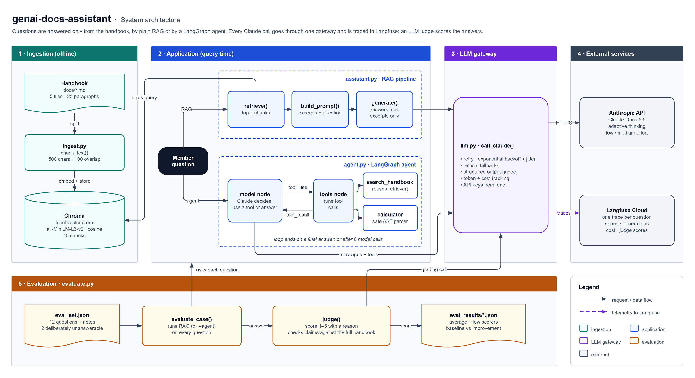

# genai-docs-assistant

An AI help desk assistant that answers questions **only from its own documents**, says plainly when the documents don't cover something, and **measures its own answer quality** with an LLM-judged eval.

It uses retrieval-augmented generation (RAG) over a local vector database, a LangGraph agent that decides when to search and when to calculate, Langfuse tracing for every step, and production habits throughout: typed functions, logging, retry with backoff, keys kept in `.env`, and 36 tests.

The documents are the member handbook of **Fernhill Works**, a fictional coworking space written for this project, so there's no real company or private data involved.

## Example

```
Q: I've used up my credit. What would 3 extra hours in the Cedar room cost?

   agent → search_handbook("Cedar room hourly price extra hours after credit used")
   agent → calculator("3 * 35")

A: Three extra hours in Cedar would cost £105. Once your credit is used up, Cedar is
   charged at £35 an hour. You can book all 3 hours at once, because a single booking
   can be up to 4 hours long. ...

Q: Is there a gym at Fernhill Works?
A: The handbook excerpts I have don't mention a gym, so I can't tell you whether
   there is one. Please ask at reception.
```

## How it works



<sub>Made in draw.io. Open [`assets/architecture.drawio`](assets/architecture.drawio) in draw.io to edit it.</sub>

| File | What it does |
| --- | --- |
| `ingest.py` | Splits the handbook into overlapping chunks and stores them in a local Chroma database |
| `assistant.py` | The RAG pipeline: `retrieve` the closest chunks, then `generate` an answer from them only |
| `agent.py` | A LangGraph `model ⇄ tools` loop. Claude chooses between `search_handbook` and a safe `calculator` |
| `evaluate.py` | Runs `eval_set.json` through the assistant, scores each answer 1–5 with an LLM judge, and compares runs |
| `llm.py` | One place for every Claude call: `.env` loading, retry with backoff, refusal handling, Langfuse cost tracking |
| `test_*.py` | 36 pytest tests. Everything except the live API calls is tested offline |

## Evaluation results

12 questions, each with notes on what a good answer must contain. Two are deliberately unanswerable from the handbook, to check the assistant admits it rather than inventing an answer.

| Run | Chunks retrieved | Average score (1–5) |
| --- | --- | --- |
| Baseline | 2 | 4.08 |
| More chunks | 5 | **4.67** (+0.58) |

What the numbers showed:

- **Fixing the judge before trusting the score.** The first judge saw only the short answer notes, so it penalised true handbook facts the notes didn't mention, like the 10% annual discount. Giving the judge the whole handbook fixed that. The baseline was re-scored with the fixed judge so the two runs compare fairly. The original run is kept as `eval_results/baseline-original-judge.json` (3.67).
- **Missed retrieval, not hallucination.** With 2 chunks, every low score was the assistant honestly saying "the handbook doesn't say" because the right chunk wasn't retrieved. Retrieving 5 chunks lifted those answers to 5/5.
- **A known limitation.** "Can I come in on a Sunday with a Flex membership?" still fails in plain RAG. "Flex membership" pulls all five results toward pricing, so the "closed on Sundays" chunk is never retrieved. The **agent** answers it correctly by searching a second time for "opening hours weekend". Hybrid keyword + vector search, or rewriting the query before searching, would fix this for plain RAG.

## Design decisions

- **Grounded answers.** The system prompt allows only facts from the retrieved excerpts, and tells the model to say when the answer isn't there and to point the user to reception.
- **Local embeddings.** Chroma's built-in all-MiniLM-L6-v2 model runs on your machine, so only the answering step needs an API key.
- **Retry with backoff.** Rate limits, overloads and network errors are retried with exponential backoff and jitter. Bad requests and bad keys fail immediately, since retrying can't fix them. The SDK's own retries are off so the two don't stack.
- **A calculator that can't run code.** It parses the expression and allows only numbers and arithmetic. `eval()` is never used on model output.
- **A structured-output judge.** The API guarantees `{reason, score}` JSON with a score from 1 to 5. The reason comes first, so the judge explains before it decides.
- **Accurate tracing.** Each question is one Langfuse trace (`answer_question` → `retrieve` → `generate` → `claude`) with timing, tokens and cost, and thinking tokens are priced as output. The Anthropic SDK's auto-instrumented spans are filtered out, since they would double-count each call.
- **Refusal fallbacks.** `fallbacks: "default"` reruns a request on a fallback model if a safety classifier wrongly declines a harmless question.

## Run it yourself

Needs Python 3.12+ and [uv](https://docs.astral.sh/uv/).

```bash
cp .env.example .env            # add ANTHROPIC_API_KEY (Langfuse keys optional)
uv run python ingest.py         # build the vector database (first run downloads an ~80 MB embedding model)
uv run pytest -v                # 36 tests, no API key needed
```

```bash
uv run python assistant.py "Can I bring my dog on a Monday?"
uv run python agent.py "What would 3 extra hours in Cedar cost?"
uv run python evaluate.py --top-k 2 --label baseline
uv run python evaluate.py --top-k 5 --label more-chunks --baseline eval_results/baseline.json
```

Optional settings in `.env`: `CLAUDE_MODEL` (default `claude-opus-5-5`) and `CLAUDE_EFFORT` (default `low`). With Langfuse keys set, open your Langfuse project's **Tracing** page to see each question's retrieval, generation, timing and cost.

## Tech stack

Python 3.12 · Anthropic Claude API · Chroma · LangGraph · Langfuse · pytest · uv

## License

[MIT](LICENSE)
